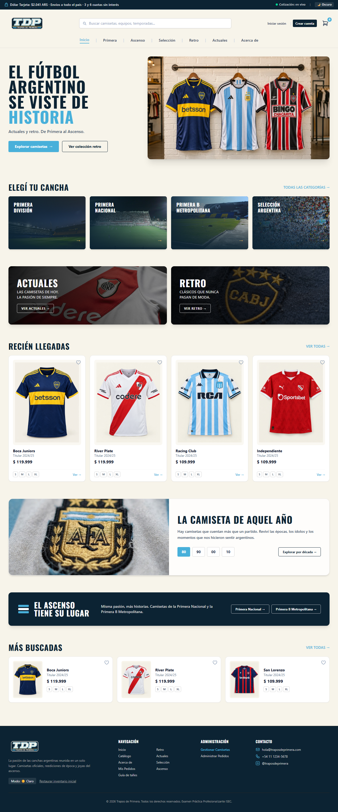
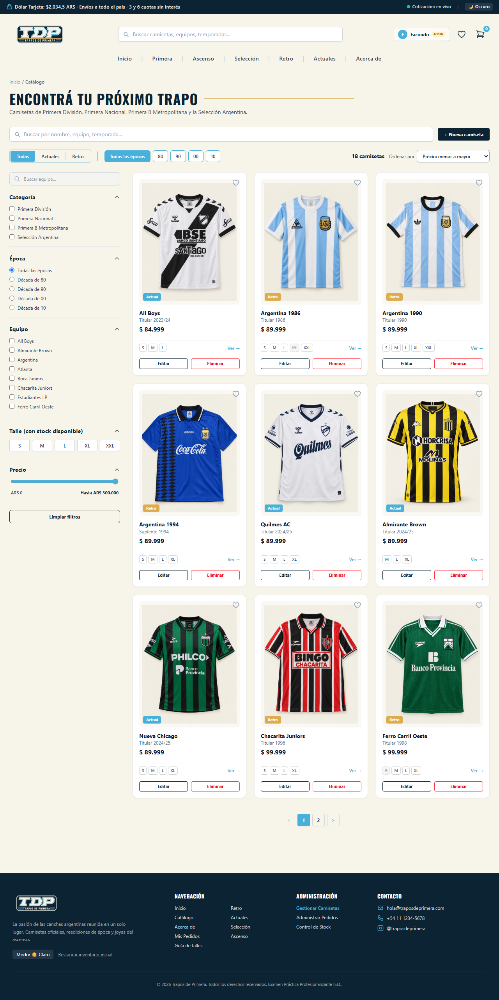
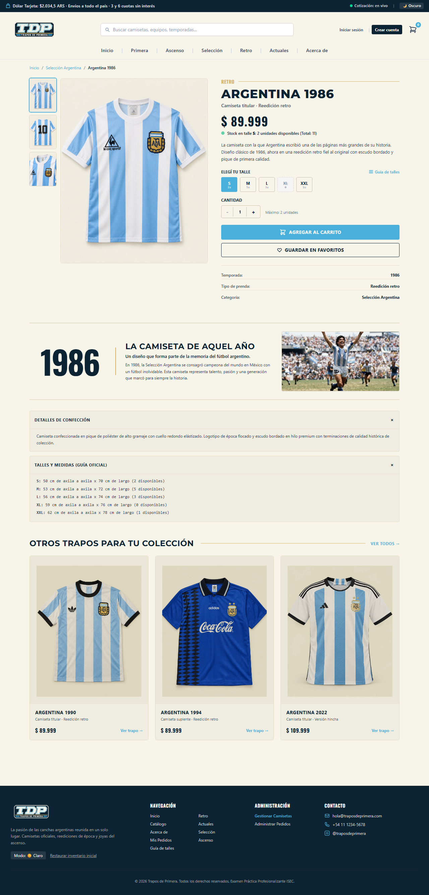
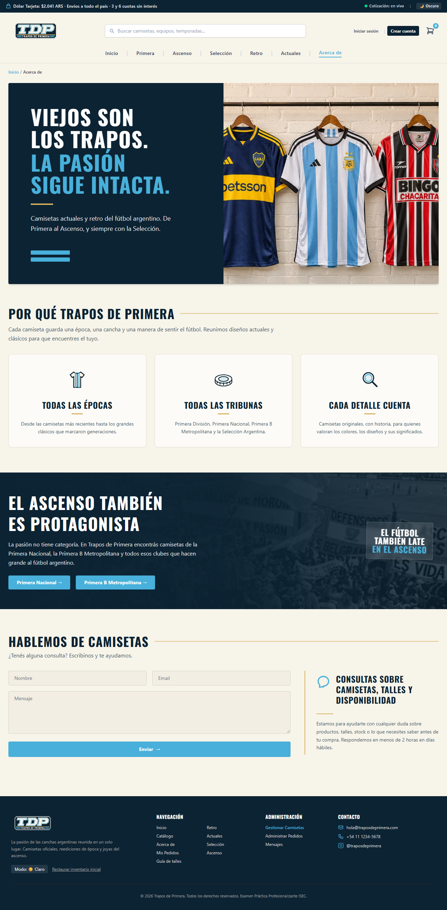
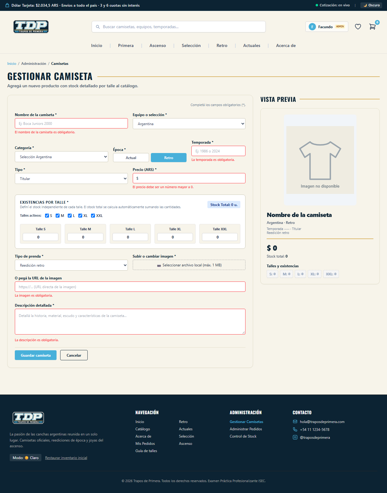
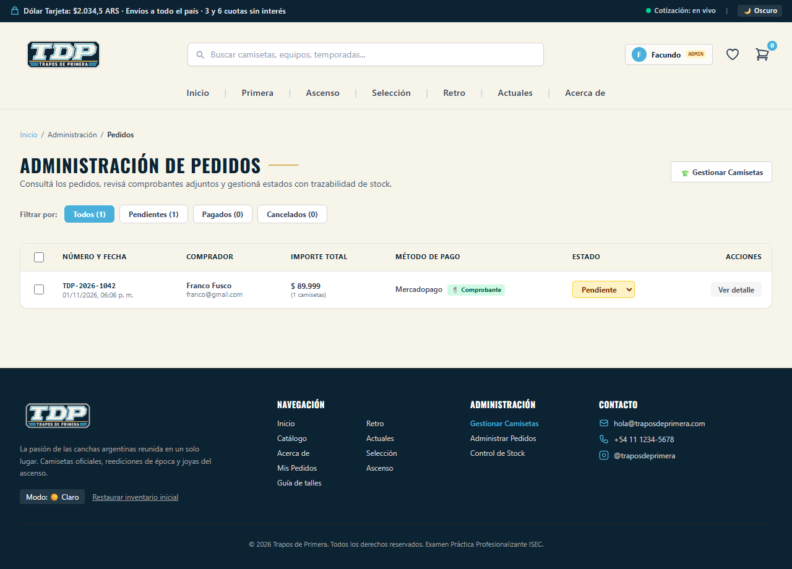
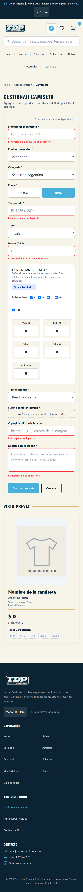
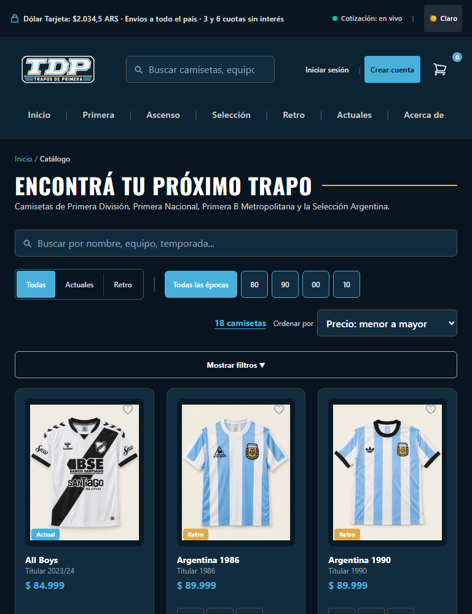

# Trapos de Primera

Trabajo Práctico Integrador de **Práctica Profesionalizante Desarrollo Web y Mobile**, Tecnicatura Superior en Diseño Multimedial, ISEC. Docente: Romero, Facundo.

## Integrantes

- [Nombre y apellido]
- [Nombre y apellido]

## Descripción

**Trapos de Primera** es una SPA (Single Page Application) hecha con Vue 3 que simula una tienda de camisetas del fútbol argentino: actuales y retro, de Primera División, Primera Nacional, Primera B Metropolitana y la Selección.

Permite gestionar un catálogo de 18 camisetas con stock por talle, buscar y filtrar, comprar con un checkout de 5 pasos y administrar los pedidos. Los datos se guardan en el `localStorage` del navegador y además se consume una API pública con `fetch`.

Es una aplicación de práctica: no hay servidor, ni cobros, ni envío real de mensajes.

## Tecnologías

| Tecnología | Uso |
|---|---|
| Vue 3.5 | Framework. Composition API con `<script setup>`, y Options API en `ScrollTopButton.vue` |
| Vue Router 5 | Rutas de la SPA y guards de acceso |
| Vite 8 | Servidor de desarrollo y compilación (ver [Nota sobre Vite](#nota-sobre-vite)) |
| TypeScript 7 | Tipado |
| Tailwind CSS 4 | Estilos y diseño responsive |
| LocalStorage | Persistencia de datos |
| Fetch API | Consumo de DolarAPI |
| Web Crypto API | Hash SHA-256 de las contraseñas |

## Instrucciones de instalación

Hace falta [Node.js](https://nodejs.org/) 20.19 o superior (o 22.12 o superior).

```bash
# 1. Instalar dependencias
npm install

# 2. Levantar el servidor de desarrollo (http://localhost:3000)
npm run dev

# Otros comandos
npm run build     # compila la app para producción en dist/
npm run preview   # sirve lo compilado en dist/
npm run lint      # chequeo de tipos con TypeScript
```

No hace falta configurar nada más. El archivo `.env.example` tiene una única variable opcional, `VITE_GOOGLE_CLIENT_ID`, explicada en [Cuentas de prueba](#cuentas-de-prueba).

## Capturas de pantalla

### Escritorio

| Inicio | Catálogo |
|---|---|
|  |  |

| Detalle | Acerca de |
|---|---|
|  |  |

| Alta con validaciones | Administración de pedidos |
|---|---|
|  |  |

**Datos de la API**


### Celular (375 px)

| Inicio | Catálogo | Detalle | Alta con validaciones |
|---|---|---|---|
|  |  |  |  |

### Tablet (768 px) en modo oscuro



## Funcionalidades implementadas

**Gestión de camisetas (CRUD)**
- Alta, edición y baja desde el rol administrador. La baja pide confirmación en un modal.
- 18 camisetas iniciales y un botón al pie, "Restaurar inventario inicial", que vuelve a ese estado.
- Stock independiente por talle (S a XXL), con cálculo automático del total.

**Búsqueda, filtros y orden**
- Buscador por texto en la barra superior y en el catálogo.
- Filtros por categoría, época, década, equipo, talle con stock y precio máximo.
- Orden por precio, recientes y nombre. Paginación de a 9 camisetas.

**Navegación**
- Rutas: `/` Inicio, `/catalogo` Listado, `/camiseta/:id` Detalle, `/admin/camisetas` Alta, `/admin/editar/:id` Edición, `/acerca-de` Acerca de, `/guia-de-talles`, `/checkout`, `/mis-pedidos`, `/admin/pedidos` y `/admin/mensajes`.
- Guards: las rutas `/admin/*` piden rol administrador; `/mis-pedidos` y `/checkout` piden sesión iniciada. Si no se cumple, redirigen al Inicio y abren el modal de login.

**Formularios y validaciones**
- Formularios con `v-model` y validaciones propias, con el mensaje de error junto a cada campo: alta y edición, login y registro, checkout y contacto.
- Se valida obligatoriedad, longitud mínima y formato (temporada, precio, stock entero, URL de imagen, email, teléfono).

**Persistencia en LocalStorage**
- Camisetas, carrito, pedidos, favoritos por usuario, usuarios, sesión y tema. Los datos sobreviven a recargar y a cerrar el navegador.

**Consumo de APIs con fetch** (`src/services/apiService.ts`)
- **DolarAPI**: la cotización del dólar tarjeta se muestra en la barra superior, en todas las páginas. Si la API falla, queda un texto fijo y la app sigue funcionando.

**Compras y pedidos**
- Carrito lateral y checkout de 5 pasos, con sesión iniciada. El comprobante de pago se puede adjuntar y se guarda en base64.
- Favoritos y pedidos por cuenta: cada una ve solo los suyos. El panel de administración ve todos los pedidos.
- Confirmar un pedido descuenta el stock de cada talle y cancelarlo lo devuelve una sola vez. Reactivar un pedido cancelado vuelve a descontar, solo si hay stock.
- Administración de pedidos con acciones masivas: selección múltiple, confirmación y resumen del resultado.
- Guía de talles con tabla de medidas.
- Mensajes de contacto: lo que se escribe en el formulario de "Acerca de" se guarda y el administrador lo lee en `/admin/mensajes`, con filtros, marcado de leídos, respuesta por correo y baja. El menú del administrador avisa cuántos hay sin leer.

**Galería de cada camiseta**
- Frente, espalda y detalle, con miniaturas y fundido entre vistas. En el celular también se pasa de una a otra deslizando.
- Las camisetas creadas a mano funcionan con una sola imagen.

**Técnicos de Vue**
- 10 componentes en `src/components/`, comunicados con props y emits.
- Propiedades computadas: `filteredJerseys`, `cartTotal`, `paginatedJerseys`, `totalPages` y otras.
- Hooks `created()` y `mounted()` en `ScrollTopButton.vue`, y `onMounted()` de Composition API, por ejemplo en `App.vue`.
- Animaciones con `<transition>` y `<transition-group>`.
- Diseño responsive para celular, tablet y escritorio, botón flotante para volver arriba y modo claro/oscuro persistente.

**Limitaciones conocidas**
- Los mensajes de contacto se guardan en el navegador, sin servidor: el administrador solo ve los que se enviaron desde ese mismo navegador.
- El login es una simulación didáctica: todo corre en el navegador, así que no ofrece seguridad real.
- Las imágenes de las camisetas son recreaciones generadas: marcas, sponsors y diseños no se contrastaron con fotos documentales.
- El inicio de sesión con Google requiere configurar un Client ID propio y no se probó de punta a punta en esta entrega. El token se decodifica sin verificar la firma.

## Cuentas de prueba

| Rol | Email | Contraseña |
|---|---|---|
| Administrador | `admin@traposdeprimera.com` | `admin123` |
| Cliente | `franco@gmail.com` | `cliente123` |

El modal de login también tiene un acceso rápido, "Ingresar como Administrador", para facilitar la corrección.

**Google (opcional):** con `VITE_GOOGLE_CLIENT_ID` configurada aparece el botón oficial de Google; sin ella, el modal indica "Google no configurado". Quien ingresa por esa vía siempre recibe el rol de cliente. El Client ID se crea en Google Cloud Console (Credenciales > ID de cliente de OAuth > Aplicación web), con `http://localhost:3000` y la URL de producción como orígenes autorizados, y se guarda en un archivo `.env.local`.

## Créditos de imágenes

Las imágenes de las camisetas (`public/assets/jerseys/`) son recreaciones generadas para este trabajo académico. Los escudos y las marcas de clubes y sponsors son de sus dueños.

Portadas de las tarjetas "Elegí tu cancha" del Inicio, enlazadas desde Wikimedia Commons (`src/data/categoryCovers.ts`). Se muestran recortadas y con un degradé encima.

| Tarjeta | Foto | Autor | Licencia |
|---|---|---|---|
| Primera División | [La Bombonera de noche](https://commons.wikimedia.org/wiki/File:Estadio_Alberto_J._Armando_field_night_view.jpg) | Ministerio de Cultura de la Nación | [CC BY-SA 2.0](https://creativecommons.org/licenses/by-sa/2.0) |
| Primera Nacional | [Tribuna de Chacarita Juniors](https://commons.wikimedia.org/wiki/File:Estadio_chacarita_juniors.jpg) | EstudiantesFotografias | [CC BY-SA 4.0](https://creativecommons.org/licenses/by-sa/4.0) |
| Primera B Metropolitana | [Estadio Don León Kolbowsky, de Atlanta](https://commons.wikimedia.org/wiki/File:Estadio_Don_Le%C3%B3n_Kolbowsky,_del_Club_Atl%C3%A9tico_Atlanta.jpg) | Ulises Icardi | [CC BY-SA 4.0](https://creativecommons.org/licenses/by-sa/4.0) |
| Selección Argentina | [Hinchada argentina en el Maracaná, final del Mundial 2014](https://commons.wikimedia.org/wiki/File:Argentinian_Fans_-_140713-8433-jikatu_(14679000633).jpg) | Jimmy Baikovicius | [CC BY-SA 2.0](https://creativecommons.org/licenses/by-sa/2.0) |

## Despliegue

URL de producción: `[URL de Vercel]`

El proyecto incluye `vercel.json`, que redirige todas las rutas a `index.html` para que funcionen al recargar o al entrar por un enlace directo. En Vercel alcanza con importar el repositorio: detecta Vite, compila con `npm run build` y publica `dist/`.

## Nota sobre Vite

Proyecto creado con Vite (sucesor oficial recomendado de Vue CLI, que está en modo mantenimiento); misma estructura de proyecto y mismo ecosistema Vue 3. La consigna pide Vue CLI; se usó Vite por lo explicado arriba.
